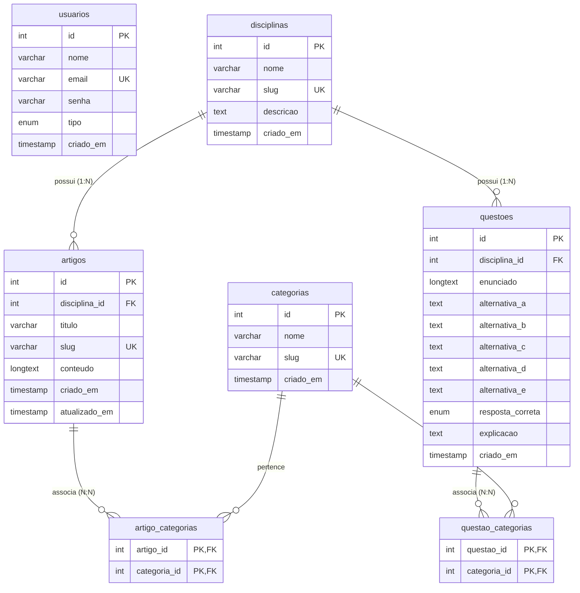

# Vest+ | Plataforma Open-Access de CMS e Banco de Questões

<p align="center">
  
</p>

<p align="center">
  <strong>Democratizando o acesso ao conhecimento pré-vestibular e ao ENEM através de uma arquitetura leve, moderna e de alto desempenho.</strong>
</p>

<p align="center">
  <a href="https://github.com/DuilioBSegura/VestMais-Project"></a>
  <a href="https://www.php.net/"></a>
  <a href="https://www.mysql.com/"></a>
  <a href="https://getbootstrap.com/"></a>
  <a href="https://developer.mozilla.org/pt-BR/docs/Web/API/Fetch_API"></a>
  <a href="LICENSE"></a>
</p>

---

## 📌 Sumário Executivo

1. [Visão Geral & Proposta de Valor](#-visão-geral--proposta-de-valor)
2. [Arquitetura & Decisões Técnicas](#-arquitetura--decisões-técnicas)
3. [Modelagem do Banco de Dados (DER)](#-modelagem-do-banco-de-dados-der)
4. [Mecanismo de Resolução Assíncrona (Fetch API)](#-mecanismo-de-resolução-assíncrona-fetch-api)
5. [Segurança e Diretrizes de Engenharia](#-segurança-e-diretrizes-de-engenharia)
6. [Guia de Instalação e Execução Local](#-guia-de-instalação-e-execução-local)
7. [Credenciais de Teste Pré-Configuradas](#-credenciais-de-teste-pré-configuradas)
8. [Suíte de Smoke Test & Garantia de Qualidade (QA)](#-suíte-de-smoke-test--garantia-de-qualidade-qa)
9. [Instruções de Git Tagging & Release](#-instruções-de-git-tagging--release)
10. [Roadmap & Plano de Evolução (v2.0)](#-roadmap--plano-de-evolução-v20)

---

## 🎯 Visão Geral & Proposta de Valor

O **Vest+** é uma plataforma educacional aberta e modular projetada para vestibulandos e candidatos do **ENEM** e dos principais vestibulares paulistas (**FUVEST, UNICAMP e UNESP**).

### Problema & Solução
Plataformas preparatórias comerciais frequentemente impõem barreiras financeiras e utilizam sistemas pesados baseados em SPAs lentas ou frameworks monolíticos complexos. O **Vest+** resolve esse gargalo ao oferecer:
- **Leitura Focada de Artigos Teóricos:** Conteúdo estruturado por disciplinas e tópicos curriculares essenciais com tipografia e espaçamento confortáveis.
- **Banco de Questões com Resolução Imediata:** Treinamento ativo através de questões de múltipla escolha (A a E) com filtros cruzados por matéria e categoria.
- **Feedback Assíncrono com Comentário Explicativo:** O estudante responde as questões sem recarregamento de página, recebendo conferência instantânea, identificação do gabarito oficial e a resolução comentada passo a passo elaborada pelo professor.

---

## 🏛️ Arquitetura & Decisões Técnicas

O projeto adota o padrão **Clean MVC (Model-View-Controller)** em **PHP puro (sem frameworks)**, privilegiando simplicidade, manutenibilidade e tempo de resposta na casa dos milissegundos.

### Destaques Arquiteturais
- **PHP 8.2+ Estrito:** Uso de `declare(strict_types=1);` em todos os scripts backend, garantindo previsibilidade de tipos em tempo de execução.
- **Zero Dependências Pesadas:** Toda a camada de persistência utiliza **PDO nativo**, e as interações do frontend operam com **Bootstrap 5 (CDN)** e **Vanilla JavaScript ES6+ (Fetch API)**.
- **Front Controller & Roteamento Centralizado:** O arquivo `public/index.php` atua como único ponto de entrada da aplicação, resolvendo URLs dinamicamente tanto para o servidor embutido do PHP quanto para servidores web tradicionais (Apache/XAMPP).
- **Controle de Acesso Baseado em Papéis (RBAC):** Separação estrita entre os perfis **Administrador** (`requireAdmin()`) e **Aluno** (`requireAuth()`).

### Estrutura de Diretórios da Codebase

```text
VestMais/
├── config/
│   ├── config.php                  # Configurações de ambiente, constantes e autoloader PSR-4
│   └── database.php                # Conexão PDO segura (Padrão Singleton/Factory)
├── database/
│   ├── schema.sql                  # DDL das tabelas base (usuarios, disciplinas, categorias)
│   └── sprint2_content.sql         # DDL de artigos, questoes, pivots N:N e seeds reais
├── public/
│   ├── api/
│   │   └── verificar_questao.php   # Endpoint RESTful direto para correção de questões
│   ├── css/
│   │   └── style.css               # Design System Verde Esmeralda / Menta (sobrescrevendo Bootstrap)
│   ├── js/
│   │   └── questoes.js             # Motor Vanilla JS para consumo assíncrono via Fetch API
│   ├── .htaccess                   # Reescrita para Front Controller no Apache
│   └── index.php                   # Front Controller & Roteador Central
├── src/
│   ├── Controllers/
│   │   ├── BaseController.php      # Base abstrata com requireAdmin, requireAuth, render e json
│   │   ├── HomeController.php      # Landing Page pública institucional
│   │   ├── AuthController.php      # Login unificado e cadastro de alunos com Bcrypt
│   │   ├── AdminDashboardController.php # Métricas consolidadas e atalhos operacionais
│   │   ├── AdminArtigoController.php   # Gestão administrativa de artigos teóricos (CRUD)
│   │   ├── AdminQuestaoController.php  # Gestão administrativa do banco de questões (CRUD)
│   │   └── AlunoController.php     # Dashboard, catálogo com filtros e resolução assíncrona
│   ├── Core/
│   │   ├── Auth.php                # Sessão, autorização RBAC e headers de segurança
│   │   ├── Csrf.php                # Geração e validação estrita de tokens anti-CSRF
│   │   ├── Flash.php               # Mensagens efêmeras de alerta (Flash Messages)
│   │   └── Helper.php              # Utilitários de URL, sanitização XSS e slugify em pt-BR
│   ├── Models/
│   │   ├── Disciplina.php          # Consultas e contagens agregadas de matérias
│   │   ├── Categoria.php           # Gestão e validação de tópicos transversais
│   │   ├── Artigo.php              # Persistência de artigos teóricos com transações N:N
│   │   └── Questao.php             # Persistência de questões, filtros e conferência de gabarito
│   └── Views/
│       ├── home.php                # Landing Page com Hero, Recursos, Grade e Equipe
│       ├── admin/
│       │   ├── dashboard.php       # Painel executivo com cards de métricas e tabelas recentes
│       │   ├── artigos/            # Listagem responsiva e formulário com gerador de slug
│       │   └── questoes/           # Tabela com preview e formulário de alternativas A-E
│       ├── aluno/
│       │   ├── dashboard.php       # Painel do estudante com contadores e banner simulado
│       │   ├── artigos.php         # Listagem de artigos teóricos por matéria
│       │   ├── artigo.php          # Visualizador imersivo e formatado do conteúdo teórico
│       │   └── questoes.php        # Catálogo com filtros combinados e cards assíncronos
│       ├── auth/
│       │   ├── login.php           # Tela de login unificado com botões rápidos de demonstração
│       │   └── register.php        # Tela de criação de conta de aluno com validação CSRF
│       └── layout/
│           ├── header.php          # Cabeçalho com navegação dinâmica por perfil de usuário
│           └── footer.php          # Rodapé com modal de exclusão Vanilla JS + CSRF
├── tests/
│   └── smoke_test.php              # Suíte autônoma de Smoke Test e QA para PHP CLI
├── .env.example                    # Modelo de variáveis de ambiente
├── .htaccess                       # Redirecionamento da raiz para a pasta /public
└── README.md                       # Documentação técnica executiva
```

---

## 🗄️ Modelagem do Banco de Dados (DER)

O banco de dados relacional foi normalizado para garantir consistência referencial, integridade de dados e consultas de agregação de alta performance.

### Diagrama Entidade-Relacionamento (Mermaid)



> **Restrições de Integridade:** Todas as chaves estrangeiras implementam `ON DELETE CASCADE ON UPDATE CASCADE`, prevenindo registros órfãos nas tabelas associativas e dependentes.

---

## ⚡ Mecanismo de Resolução Assíncrona (Fetch API)

O fluxo de resolução de questões na área do aluno foi concebido para máxima responsividade, eliminando recarregamentos de página (*full reload*):

```text
[Estudante] ──(Marca uma alternativa de A a E e submete)
     │
     ▼
[public/js/questoes.js]
     ├── event.preventDefault()
     ├── Valida seleção do formulário
     └── Ativa estado de carregamento (Spinner Bootstrap & bloqueio de botão)
     │
     ▼ (POST /api/questoes/verificar com Content-Type: application/json)
[AlunoController::verificarQuestao()]
     ├── Valida sessão autenticada (requireAuth)
     ├── Consulta questão de forma segura via Prepared Statement
     └── Avalia a alternativa enviada contra resposta_correta
     │
     ▼ (HTTP 200 JSON Response)
{
  "sucesso": true,
  "correta": true,
  "gabarito": "C",
  "explicacao": "Resolução comentada passo a passo..."
}
     │
     ▼
[Atualização Dinâmica do DOM]
     ├── Alternativa correta destacada com borda e fundo verde (.border-success .bg-success-subtle)
     ├── Alternativa incorreta (se houver) destacada em vermelho (.border-danger .bg-danger-subtle)
     └── Caixa de feedback revelada com o gabarito oficial e a explicação do professor
```

---

## 🛡️ Segurança e Diretrizes de Engenharia

| Requisito de Segurança | Implementação no Vest+ |
| :--- | :--- |
| **SQL Injection** | 100% das queries utilizam Prepared Statements PDO com bind tipado de parâmetros. Zero interpolação de strings em SQL. |
| **Cross-Site Scripting (XSS)** | Sanitização estrita de saídas dinâmicas no HTML utilizando `htmlspecialchars($str, ENT_QUOTES \| ENT_SUBSTITUTE, 'UTF-8')`. |
| **Cross-Site Request Forgery (CSRF)** | Tokens de 256 bits gerados via `random_bytes(32)`, persistidos na sessão e validados em tempo constante com `hash_equals()`. |
| **Armazenamento de Credenciais** | Senhas criptografadas com algoritmo padrão **Bcrypt** através da API nativa `password_hash()` e `password_verify()`. |
| **Integridade de Transações** | Operações que envolvem múltiplas tabelas (ex.: artigos/questões e tabelas associativas N:N) rodam sob transações atômicas com `beginTransaction()`, `commit()` e `rollBack()`. |

---

## 🚀 Guia de Instalação e Execução Local

### Pré-requisitos
- **PHP 8.2 ou superior** instalado no ambiente (com extensões `pdo_mysql` e `mbstring` ativas).
- **MySQL 8.0+** ou **MariaDB 10.4+** em execução.
- **Git** instalado.

---

### Passo 1: Clonar o Repositório
```bash
git clone https://github.com/DuilioBSegura/VestMais-Project.git
cd VestMais-Project
```

---

### Passo 2: Configurar o Banco de Dados
1. Inicie o servidor MySQL/MariaDB.
2. Crie a base de dados `vestplus` e execute as migrações na ordem indicada:

**Via Terminal MySQL/MariaDB:**
```bash
mysql -u root -p -e "CREATE DATABASE IF NOT EXISTS vestplus CHARACTER SET utf8mb4 COLLATE utf8mb4_unicode_ci;"
mysql -u root -p vestplus < database/schema.sql
mysql -u root -p vestplus < database/sprint2_content.sql
```

**Ou via phpMyAdmin:**
- Crie o banco de dados `vestplus`.
- Importe o arquivo `database/schema.sql`.
- Importe o arquivo `database/sprint2_content.sql`.

---

### Passo 3: Executar a Aplicação

#### Opção A: Servidor Embutido do PHP (Recomendado para Desenvolvimento)
Execute o comando a partir da raiz do projeto:
```bash
php -S localhost:8000 -t public
```
Acesse a aplicação no navegador em:
👉 **[http://localhost:8000](http://localhost:8000)**

#### Opção B: Ambiente Apache / XAMPP
1. Mova ou clone a pasta do projeto para `c:\xampp\htdocs\VestMais`.
2. Certifique-se de que os módulos **Apache** e **MySQL** estão ativos no painel do XAMPP.
3. Acesse diretamente:
👉 **[http://localhost/VestMais](http://localhost/VestMais)** ou **[http://localhost/VestMais/public](http://localhost/VestMais/public)**

---

## 🔑 Credenciais Homologadas para Avaliação Técnica

Para agilizar a avaliação técnica, a tela de login (`/login`) conta com **botões de preenchimento automático em 1 clique**:

| Papel | E-mail | Senha | Área de Destino |
| :--- | :--- | :--- | :--- |
| **Administrador Real** | `duiliobsegura@gmail.com` | `AdminVest@2026` | Painel Administrativo (`/admin/dashboard`) |
| **Estudante (Aluno)** | `estudante@vestmais.com.br` | `AlunoVest@2026` | Dashboard do Aluno (`/aluno/dashboard`) |

---

## 🧪 Suíte Completa de Auditoria Técnica & QA (Pré-Apresentação)

O projeto inclui duas ferramentas autônomas de verificação executáveis via PHP CLI nativo, sem exigir PHPUnit ou Composer:

### 1. Suíte de Auditoria Global (18 Verificações - Segurança, Banco, Acessibilidade e Performance)
```bash
php tests/audit_suite.php
```

### 2. Suíte de Smoke Test & Integridade
```bash
php tests/smoke_test.php
```

### Documentação Complementar para Apresentação:
- **Roteiro Oficial da Apresentação:** Consulte [docs/ROTEIRO_APRESENTACAO.md](docs/ROTEIRO_APRESENTACAO.md) para o passo a passo cronometrado e matriz de contingência.
- **Checklist WCAG AA & Responsividade:** Consulte [tests/frontend_checklist.md](tests/frontend_checklist.md) para a matriz de contraste e quebras de layout.
- **Otimização de Índices SQL:** Script [database/indexes_optimization.sql](database/indexes_optimization.sql) para consultas abaixo de 50ms.

---

## 🏷️ Instruções de Git Tagging & Release

Para congelar formalmente o estado da versão `v1.0.0` no repositório GitHub (`https://github.com/DuilioBSegura/VestMais-Project`):

```bash
# 1. Configurar o repositório remoto (se ainda não configurado)
git remote add origin https://github.com/DuilioBSegura/VestMais-Project.git

# 2. Adicionar todos os arquivos das Sprints 1, 2, 3 e a suíte de QA
git add .

# 3. Realizar o commit de consolidação da release
git commit -m "chore(release): v1.0.0 - final MVP delivery with student area and QA suite"

# 4. Criar a tag anotada com descrição oficial
git tag -a v1.0.0 -m "Release v1.0.0: MVP completo com CMS de Artigos, Banco de Questões e Resolução Assíncrona"

# 5. Sincronizar o branch principal e a tag com o GitHub
git branch -M master
git push -u origin master
git push origin v1.0.0
```

---

## 🔮 Roadmap & Plano de Evolução (v2.0)

- [ ] **Módulo de Turmas e Docência:** Criação de turmas por professores com atribuição direcionada de listas de exercícios.
- [ ] **Modo Simulado Cronometrado:** Provas cronometradas no modelo oficial do ENEM (90 questões, temporizador regressivo e submissão em lote).
- [ ] **Persistência de Histórico do Estudante:** Tabela de respostas para compor painel com taxa de acertos e diagnósticos de pontos fracos por matéria.
- [ ] **Renderizador Matemático KaTeX / LaTeX:** Suporte nativo à renderização de fórmulas matemáticas e químicas nos enunciados.
- [ ] **Exportação para PDF:** Geração de cadernos de simulados e listas de revisão prontas para impressão.

---

## 📄 Licença

Este projeto é distribuído sob os termos da licença **MIT**. Consulte o arquivo [LICENSE](LICENSE) para mais detalhes.

---

<p align="center">
  Desenvolvido com foco em excelência arquitetural e impacto educacional. &bull; <strong>Vest+ Platform 2026</strong>
</p>
