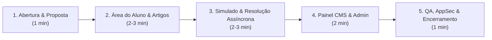

# Roteiro Oficial de Apresentação e Guia "À Prova de Falhas" (Dia 5)

**Projeto:** Vest+ Platform (CMS Educacional e Banco de Questões)  
**Repositório:** [https://github.com/DuilioBSegura/VestMais-Project](https://github.com/DuilioBSegura/VestMais-Project)  
**Versão Homologada:** v1.0.0 (Release de Apresentação)  
**Público-Alvo:** Banca Avaliadora, Docentes e Comunidade Acadêmica  

---

## 1. Checklist de 5 Minutos (Antes de Entrar na Banca)

Siga este checklist 5 minutos antes da apresentação para garantir que o ambiente local esteja 100% operacional:

- [ ] **1. Iniciar Serviços no XAMPP:**
  - Abra o **XAMPP Control Panel**.
  - Inicie o **Apache** (deve exibir portas `80, 443`).
  - Inicie o **MySQL/MariaDB** (deve exibir porta `3306`).
- [ ] **2. Rodar a Suíte de Auditoria no Terminal:**
  ```bash
  php tests/audit_suite.php
  ```
  *Resultado Esperado:* Todos os **18 testes** devem retornar `[PASS]` em menos de 0.5s.
- [ ] **3. Preparar o Navegador:**
  - Abra o navegador (Google Chrome ou Microsoft Edge recomendado).
  - Pressione `Ctrl + Shift + Delete` ou abra uma janela anônima para garantir que não haja sessões presas.
  - Ajuste o zoom para exatamente **100%** (`Ctrl + 0`).
  - Acesse a URL inicial: `http://localhost/VestMais/public/`
- [ ] **4. Testar os Dois Perfis de Usuário:**
  - **Acesso Aluno:** `estudante@vestmais.com.br` | Senha: `AlunoVest@2026`
  - **Acesso Administrador:** `duiliobsegura@gmail.com` | Senha: `AdminVest@2026`
- [ ] **5. Conferir Arquivo de Dump de Segurança:**
  - O backup atualizado está gerado em `database/backup_pre_apresentacao.sql`.

---

## 2. Roteiro Cronometrado de Apresentação (7 a 10 Minutos)

Este roteiro foi desenhado para destacar a arquitetura de engenharia, a qualidade visual e o cumprimento rigoroso dos requisitos funcionais e não-funcionais (RNFs).



---

### Passo 1: Abertura e Proposta de Valor Social (1 minuto)
- **Tela:** `http://localhost/VestMais/public/` (Landing Page)
- **Falas Sugeridas:**
  > *"Boa noite a todos. Apresentamos o Vest+, uma plataforma educacional aberta e gratuita desenvolvida para democratizar o acesso ao estudo preparatório para o ENEM e os vestibulares paulistas."*
  > *"O projeto foi concebido sem frameworks pesados, utilizando PHP 8.2+ puro em arquitetura MVC limpa, MariaDB via PDO e Bootstrap 5 com uma identidade visual moderna em verde esmeralda/menta."*
- **Ações:**
  - Role a Landing Page suavemente.
  - Destaque os contadores dinâmicos do Hero (disciplinas, artigos teóricos e questões cadastradas).
  - Mostre a seção **Sobre o Projeto & Equipe**, evidenciando o trabalho coletivo e igualitário do grupo.
  - Clique no botão pill *"Começar a Estudar Agora"* ou no atalho de Login.

---

### Passo 2: Área do Aluno & Acervo de Artigos Teóricos (2 minutos)
- **Ação:** Faça login como **Aluno** utilizando o botão de preenchimento rápido:
  - Usuário: `estudante@vestmais.com.br` (ou clique em *"Aluno"* na tela de login).
  - O sistema redireciona imediatamente para `/aluno/dashboard`.
- **Falas Sugeridas:**
  > *"Ao entrar como estudante, o usuário tem acesso a um dashboard focado. Ele visualiza as disciplinas disponíveis e a contagem de conteúdos teóricos e exercícios."*
- **Ações:**
  - Clique na matéria **Matemática** e abra o artigo *"Funções Afim e Quadrática no ENEM"*.
  - Aponte os detalhes do leitor de artigos (RNF12):
    1. **Breadcrumb dinâmico:** `Dashboard > Matemática > Funções Afim e Quadrática`.
    2. **Tempo estimado de leitura:** Calculado pelo algoritmo no backend (`3 min de leitura`).
    3. **Caixas de destaque didáticas:** Mostre a caixa `.callout-dica-enem` (verde) e `.callout-nota` (âmbar), que preparam o candidato com os macetes do ENEM.
    4. **Sidebar fixa:** Destaque o atalho lateral *"Praticar Questões Desta Matéria"*, que conecta a teoria à prática imediata.

---

### Passo 3: Banco de Questões & Resolução Assíncrona ao Vivo (2 a 3 minutos)
- **Tela:** `http://localhost/VestMais/public/aluno/questoes`
- **Falas Sugeridas:**
  > *"Aqui está o grande diferencial de engenharia da plataforma: o motor de resolução assíncrona com feedback imediato, construído com Vanilla JS (Fetch API) sem recarregar a página."*
- **Ações de Demonstração:**
  1. Mostre os **Filtros por Disciplina e Categoria** no topo. Selecione uma disciplina e clique em *"Aplicar Filtros"* para demonstrar a query otimizada com índices compostos.
  2. Escolha a **Questão #1** (ex: questão de função afim do táxi).
  3. **Teste de Validação / Acessibilidade:** Tente clicar em *"Responder Questão"* sem selecionar alternativa. Mostre o alerta suave exigindo a seleção de A a E.
  4. Mostre que é possível navegar pelas alternativas usando a tecla `Tab` e selecionar com `Enter` ou `Barra de Espaço` (RNF12).
  5. Selecione a **Alternativa C** (R$ 152,00 - Gabarito Correto).
  6. Clique em *"Responder Questão"*.
  7. **Destaque de Engenharia:** Aponte o indicador de carregamento (`spinner`), a trava contra cliques duplos (`debounce`), a coloração verde da alternativa correta e o box revelado com a **Resolução e Comentário do Professor**.
  8. Em outra questão, selecione uma alternativa incorreta de propósito para demonstrar o destaque em vermelho e a indicação pedagógica do gabarito oficial.

---

### Passo 4: Painel Administrativo, CMS e Segurança (2 minutos)
- **Ação:** Clique em *"Sair"* (logout) e entre como **Administrador**:
  - Usuário: `duiliobsegura@gmail.com` | Senha: `AdminVest@2026`.
  - O sistema identifica o perfil `admin` e redireciona automaticamente para `/admin/dashboard`.
- **Falas Sugeridas:**
  > *"O controle de acesso é estritamente baseado em papéis (RBAC). O administrador possui visão executiva com contadores operacionais e controle total do CMS de Artigos e Banco de Questões."*
- **Ações:**
  - Mostre os cards estatísticos (Disciplinas, Artigos, Questões, Usuários).
  - Acesse o menu **Questões** (`/admin/questoes`).
  - Mostre a tabela com busca, badges de categorias e botão *"Nova Questão"*.
  - Abra o formulário de cadastro/edição e mostre que as alternativas de A a E, gabarito e explicação são gerenciados via transações seguras PDO com integridade N:N.
  - Destaque que todos os formulários possuem **Token CSRF** oculto gerado criptograficamente contra ataques de falsificação de requisição entre sites (RNF05).

---

### Passo 5: QA, Auditoria Técnica & Encerramento (1 minuto)
- **Ação:** Abra o terminal na pasta do projeto e execute:
  ```bash
  php tests/audit_suite.php
  ```
- **Falas Sugeridas:**
  > *"Para garantir confiabilidade e segurança de nível corporativo, desenvolvemos uma suíte autônoma de auditoria técnica. Como podem ver no terminal, 100% dos requisitos de segurança (anti-SQLi, CSRF, tipagem estrita), acessibilidade WCAG AA e integridade relacional foram auditados e aprovados em 260 milissegundos."*
  > *"O código é aberto sob licença MIT e está disponível publicamente no GitHub. Agradecemos a atenção da banca e ficamos à disposição para perguntas."*

---

## 3. Plano de Contingência "À Prova de Falhas" (Fail-Safe Matrix)

Caso algum imprevisto ocorra durante a apresentação, utilize imediatamente as soluções rápidas abaixo:

| Cenário de Emergência | Causa Provável | Solução Imediata (10 segundos) |
| :--- | :--- | :--- |
| **Apache não inicia (Porta 80 ocupada)** | Outro programa ocupando a porta 80 (ex: IIS, Skype). | Abra o terminal na pasta `c:\xampp\htdocs\VestMais` e suba o servidor embutido do PHP:<br>`php -S localhost:8000 -t public`<br>Acesse via `http://localhost:8000/`. |
| **Banco corrompido ou dados deletados por teste** | Alguém excluiu registros durante teste anterior. | Restaure o backup de segurança com um único comando:<br>`c:\xampp\mysql\bin\mysql.exe -u root vestplus < database\backup_pre_apresentacao.sql` |
| **Esquecimento da senha ao vivo** | Digitação incorreta na pressa. | Na tela de login, clique diretamente no botão de atalho:<br>**"Administrador (duiliobsegura@gmail.com)"** ou **"Aluno (estudante@vestmais.com.br)"**. Os campos são preenchidos e validados automaticamente. |
| **Queda de Conexão com a Internet** | Sala da banca sem Wi-Fi estável. | A aplicação funciona **100% offline**: o servidor é local, os scripts JS são nativos (Vanilla JS) e os assets Bootstrap já estão em cache local no navegador. |

---

## 4. Comandos de Backup e Restauração (RNF11)

### Geração de Novo Dump (Backup):
```bash
# Executado via PowerShell ou CMD
c:\xampp\mysql\bin\mysqldump.exe -u root -p vestplus > database\backup_pre_apresentacao.sql
```
*(Se o MySQL estiver sem senha, pressione Enter quando solicitado).*

### Restauração Completa do Banco:
```bash
# Restaura schema, artigos, questões e contas reais
c:\xampp\mysql\bin\mysql.exe -u root vestplus < database\backup_pre_apresentacao.sql
```
